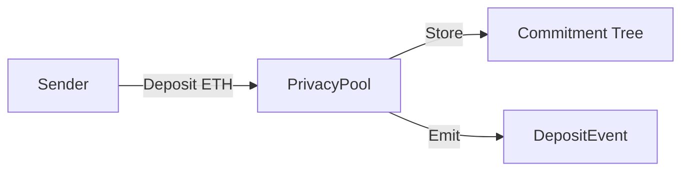
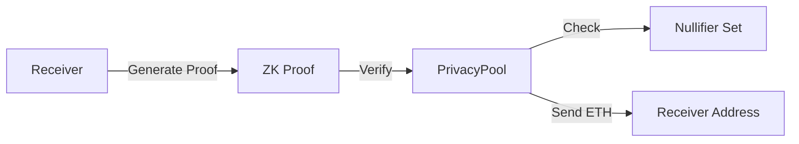

# SafeSend Privacy System

A production-ready privacy-preserving transaction system built on Ethereum using zero-knowledge proofs.

## System Architecture

### Core Components

1. **PrivacyPool.sol**
   - Main contract handling deposits and withdrawals
   - Manages commitment tree and nullifier set
   - Implements rate limiting and security controls
   - Handles emergency functions and pausing

2. **ProductionVerifier.sol**
   - Verifies zero-knowledge proofs
   - Implements Groth16 verification
   - Manages proof caching for gas optimization
   - Handles verification key updates

3. **PrivacyClient.sol**
   - User-friendly interface for privacy pool interactions
   - Manages user registration and rate limiting
   - Handles fee collection and batch operations
   - Provides helper functions for commitment/nullifier generation

4. **PrivacyUtils.sol**
   - Library for cryptographic operations
   - Generates commitments and nullifiers
   - Implements Merkle tree utilities
   - Provides security validation functions

### Zero-Knowledge Components

1. **PrivacyProof.circom**
   - Circuit for proving private transactions
   - Verifies commitment ownership
   - Validates Merkle path inclusion
   - Ensures nullifier correctness

## System Workflow

### 1. Deposit Flow


1. Sender generates commitment for receiver
2. Sends ETH to privacy pool with commitment
3. Pool adds commitment to Merkle tree
4. Event emitted for off-chain tracking

### 2. Withdrawal Flow


1. Receiver generates ZK proof of ownership
2. Submits proof and withdrawal request
3. Pool verifies proof and nullifier
4. ETH transferred to receiver

## Security Features

1. **Access Control**
   - Ownable pattern for admin functions
   - Role-based access for operations
   - Emergency pause functionality

2. **Rate Limiting**
   - Maximum 10 deposits per day
   - Maximum 10 ETH per day
   - Minimum 0.01 ETH deposit

3. **Anti-MEV Protection**
   - 1-hour withdrawal delay
   - Batch operations support
   - Front-running protection

4. **Privacy Guarantees**
   - Zero-knowledge proofs for withdrawals
   - Nullifier prevention of double-spends
   - Commitment hiding for receiver privacy

## Current Status

### Completed
- ✅ Core smart contract architecture
- ✅ Security features implementation
- ✅ Client interface with batching
- ✅ Basic test infrastructure
- ✅ Production-ready contract structure

### In Progress
- 🔄 Zero-knowledge proof integration
- 🔄 Comprehensive test suite
- 🔄 Circuit compilation setup

## Future Tasks

### High Priority
1. **ZK Proof Integration**
   - Complete circom circuit setup
   - Implement trusted setup ceremony
   - Generate and integrate verifier contract

2. **Testing**
   - Add property-based tests
   - Implement stress testing
   - Add integration tests with real proofs

3. **Security**
   - External audit
   - Formal verification
   - Bug bounty program

### Medium Priority
1. **Optimizations**
   - Gas optimization for batch operations
   - Proof caching improvements
   - Merkle tree optimization

2. **Features**
   - Multi-asset support
   - Cross-chain privacy
   - Advanced fee mechanisms

### Low Priority
1. **Documentation**
   - Technical whitepaper
   - Integration guides
   - API documentation

## Development Setup

### Prerequisites
- Node.js v18+
- Foundry
- Circom 2.1.4
- Rust (for circom compilation)

### Installation
```bash
# Install dependencies
npm install

# Install Foundry
curl -L https://foundry.paradigm.xyz | bash
foundryup

# Build contracts
forge build

# Run tests
forge test
```

### Running Tests
```bash
# Run all tests
forge test -vvv

# Run specific test
forge test --match-test testCompletePrivacyFlow -vvv
```

## Contributing

1. Fork the repository
2. Create feature branch
3. Commit changes
4. Push to branch
5. Create Pull Request

## License

MIT License - see LICENSE file for details
